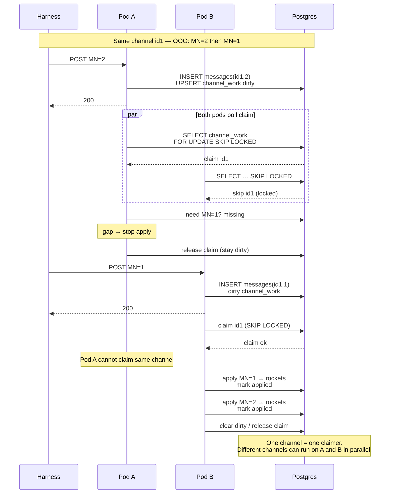

# Lunar Backend Engineer Challenge

Challenge materials and working notes live under [`docs/`](docs/).

- [Requirements](docs/REQUIREMENTS.md) — original challenge brief
- [Brief](docs/BRIEF.md)
- [Spec](docs/SPEC.md)
- [Requirements checklist](docs/REQUIREMENTS_CHECKLIST.md)
- [Next steps](docs/NEXT_STEPS.md) — deferred prod trade-offs (e.g. wake-on-ingest)

See also [`AGENTS.md`](AGENTS.md) for agent guidance.

## Local up (P0 scaffold)

Requires Java 21, Docker, and Maven Wrapper (`./mvnw`).

```bash
make up          # Postgres on localhost:5432 (user/db/password: lunar)
make test        # Testcontainers smoke + schema ITs
make run         # Spring Boot on http://localhost:8088
curl -s http://localhost:8088/actuator/health
```

All-in-Docker (optional): `docker compose up --build` (app + Postgres; app on **8088**).

Default datasource: `jdbc:postgresql://localhost:5432/lunar` (override with `SPRING_DATASOURCE_*`).

## Architecture / Apply concurrency

Ingest is durable and first-wins; apply is async. Workers claim dirty channels with Postgres `FOR UPDATE SKIP LOCKED` so **one channel has one claimer**, while different channels can run in parallel across pods. Out-of-order message numbers stay buffered until the contiguous next MN is present (gap → release claim, stay dirty).



## Test harness

Platform trees under [`rockets/`](rockets/) (`darwin_*`, `linux_*`, `windows_*`) ship the official `rockets` challenge binaries from the assessment ZIP (~9MB each). They are committed so the harness is available without re-downloading.

Example (Apple Silicon):

```bash
./rockets/darwin_arm64/rockets launch "http://localhost:8088/messages"
```
