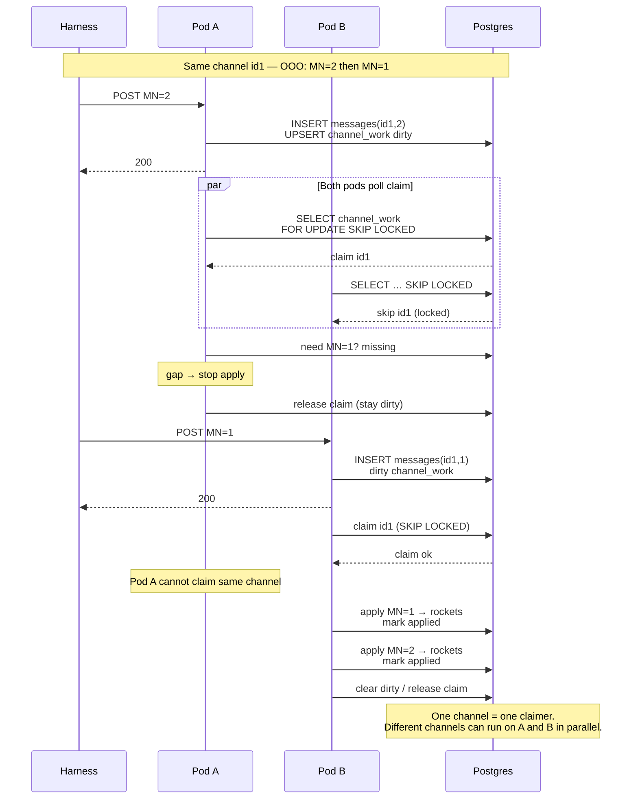

# Lunar Rockets

Harness-driven rocket state service for the Lunar backend engineer challenge: durable `POST /messages` ingest, async contiguous apply into a `rockets` projection, and `GET /rockets` reads.

Challenge materials and working notes live under [`docs/`](docs/).

- [Requirements](docs/REQUIREMENTS.md) — original challenge brief
- [Brief](docs/BRIEF.md) · [Spec](docs/SPEC.md) · [Architecture](docs/ARCHITECTURE.md)
- [Requirements checklist](docs/REQUIREMENTS_CHECKLIST.md)
- [Plans](docs/plans/) · [Next steps](docs/NEXT_STEPS.md) (deferred wake-on-ingest)
- [AI usage](AI_USAGE.md)

See also [`AGENTS.md`](AGENTS.md) for agent guidance.

## Stack

Java **21** · Spring Boot **3.x** · Maven Wrapper · Postgres **16** (Docker) · Flyway · JSON Schema validation (networknt) · Jacoco coverage gate · vendor harness under [`rockets/`](rockets/).

Runtime: Spring virtual threads enabled (`spring.threads.virtual.enabled=true` in `application.yml`) so Tomcat request handling uses Java 21 virtual threads.

Single Spring Boot deployable with package seams `ingest` / `apply` / `read` (not multi-module / microservices for this exercise).

## Local up

Requires Java 21, Docker, and `./mvnw`.

```bash
make up          # Postgres + Spring Boot app (compose); API on http://localhost:8088
make db-up       # Postgres only on localhost:5432 (user/db/password: lunar)
make run         # host JVM Spring Boot on :8088 (use after make db-up)
make smoke       # actuator health UP
make down        # stop compose stack and remove volumes
```

Default datasource: `jdbc:postgresql://localhost:5432/lunar` (override with `SPRING_DATASOURCE_*`).

## APIs

| Method | Path | Notes |
| --- | --- | --- |
| `POST` | `/messages` | Always **200** on accept (including first-wins duplicates). **400** malformed / unknown type / negative `by`. **5xx** transient. |
| `GET` | `/rockets` | Empty → `200` + `[]`. Sort: `sort=speed\|mission\|type` + `order=asc\|desc` (default asc). Default order by id. Invalid sort/order → **400**. |
| `GET` | `/rockets/{id}` | Applied projection fields. Unknown → **404**. |

Client errors (**400** / **404**) and ingest **503** return JSON: `{"status":…,"error":"…","message":"…"}` (e.g. invalid sort → `"Invalid sort: missionn"`).

Response fields: `id`, `type`, `speed`, `mission`, `exploded`, `explosionReason`.

```bash
curl -sS -X POST http://localhost:8088/messages -H 'Content-Type: application/json' -d @payload.json
curl -sS 'http://localhost:8088/rockets?sort=speed&order=desc' | jq .
curl -sS "http://localhost:8088/rockets/$ID" | jq .
```

## Tests & coverage

```bash
make test        # ./mvnw verify (unit + Testcontainers ITs + Jacoco report + LINE ≥ 90% check)
make coverage    # same, then prints Jacoco LINE summary
```

Report: `target/site/jacoco/index.html` (and `jacoco.xml`). Coverage bar is measured **LINE** coverage **> 90%** (Jacoco `check` fails the build at ≤ 90%).

Automated e2e-oriented IT covers out-of-order POST + duplicate first-wins → apply → GET (`OutOfOrderDuplicateApplyReadIT`).

## Harness

Platform trees under [`rockets/`](rockets/) ship the official challenge binaries. On Apple Silicon:

```bash
# pick binary: uname -m → arm64 ⇒ darwin_arm64; x86_64 ⇒ darwin_amd64
./rockets/darwin_arm64/rockets launch "http://localhost:8088/messages" \
  --max-messages=200
# stress (non-default delay + concurrency):
./rockets/darwin_arm64/rockets launch "http://localhost:8088/messages" \
  --message-delay=50ms --concurrency-level=8 --max-messages=400
```

Wait for apply catch-up (`messages.applied = false` → 0 for contiguous harness sequences) before trusting GETs. P4 evidence: defaults + stress on `darwin_arm64` against compose app on **8088**, then `GET /rockets` length matched `rockets` rows, sample get-by-id matched DB, `sort=speed&order=desc` ordered, unknown id → **404**.

Automated live check (app up + harness + read asserts):

```bash
make e2e-harness   # ensure UP, run smoke-sized harness via recording proxy,
                   # capture EVERY channel from POSTs, poll apply, assert GET list+detail for all
# knobs: E2E_MAX_MESSAGES=60 E2E_MESSAGE_DELAY=100ms E2E_CONCURRENCY=1
```

`scripts/e2e_harness.py` proxies harness POSTs (stdout has no UUIDs), first-wins-records envelopes for all channels, truncates `messages`/`channel_work`/`rockets` so seed-stable IDs match this run, reduces expected state (mission / speed / exploded), asserts every channel, and prints green `PASS` or red `FAIL: channel <id> field <name>: …` (`--no-reset-db` to keep prior rows).

## Design / trade-offs (interview anchors)

- **Durable ingest → 200; async contiguous apply** (SPEC option 3 + B): short ingest txn inserts into `messages` and dirties `channel_work`; apply scheduler polls and projects into `rockets`.
- **Multi-pod:** `FOR UPDATE SKIP LOCKED` claim on `channel_work` + `rockets.version` optimistic concurrency — one channel, one claimer; different channels parallel across pods.
- **First-wins duplicates** on `(channel, messageNumber)`; **sticky explode** then continue applying later contiguous messages; **speed may be ≤ 0** (no clamp); negative `by` rejected at ingest (**400**).
- **Single deployable** with `ingest` / `apply` / `read` packages.
- **Prod note (docs only):** Aurora-style writer for ingest/apply + readers for GET when eventual consistency is acceptable — not implemented here.
- **Deferred:** same-pod wake-on-ingest hint → [`docs/NEXT_STEPS.md`](docs/NEXT_STEPS.md).



## Known OPENs

- Missing / late `RocketLaunched`: buffer vs invent — not invented here; non-launch before launch fails closed at apply.
- Huge `by` / overflow: store and compute as `long`; document rather than invent UX.
