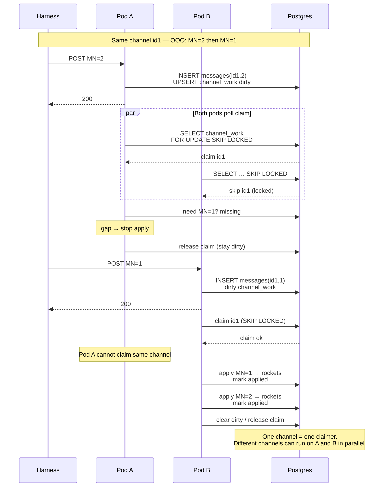

# P2 — Apply scheduler Implementation Plan

> **For agentic workers:** Prefer TDD (failing tests first). Combined plan+impl commit after Driver OK (per preferences). **Do not implement until Driver approves this plan.** No commit / push / PR until Driver OK.

**Status:** PASS / done (implemented; poll + DB claim; committed on main).

**Goal:** After durable ingest, asynchronously **claim** dirty channels via Postgres `channel_work` + `SELECT … FOR UPDATE SKIP LOCKED`, then **apply contiguous** `messageNumber`s into `rockets` current-state — multi-pod safe, optimistic `rockets.version`, sticky explode + continue, gaps pause that channel until MN is contiguous. **No HTTP API changes in this phase** (no new ingest contract; no GET rockets).

**Architecture:** Build on P0/P1 (`messages`, `rockets`, `channel_work`). Logic lives under package `com.lunar.rockets.apply`. In-process scheduler/worker (Spring `@Scheduled` or equivalent) polls DB; **DB claim is source of truth**. **P2 = poll + DB claim only** — no wake-on-ingest. Same-pod wake-after-ingest is deferred to living `docs/NEXT_STEPS.md` (prod latency optimization; correctness already holds via scheduler + `channel_work`). First-wins duplicates already enforced at ingest — apply marks `messages.applied` and must never double-apply deltas. Contiguous progress = `rockets.last_applied_number` (+ per-row `applied` flag). Read APIs remain **P3**.

**Apply concurrency (multi-pod):** same channel → exclusive claim via `SKIP LOCKED`; OOO MN stays dirty until contiguous; different channels may run on different pods in parallel.



**Tech stack (locked):** Java 21 · Spring Boot 3.x · Maven · Spring Data JPA (+ native SQL for claim / CAS) · Flyway (V1 + **V2** for `messages.applied` if needed) · PostgreSQL · Testcontainers for IT · single Spring Boot deployable

**Depends on:** P0 schema + P1 durable ingest + `channel_work` dirty upsert; P1.1 harness smoke already proved accept path (not a hard dep for apply unit/IT).

**Follows:** **P3** — `GET /rockets`, `GET /rockets/{id}`, sort.

---

## Global constraints

- Contiguous apply only: apply `N` iff `N == last_applied_number + 1`; **gap ⇒ stop that channel** until the missing number is present (do not skip ahead).
- Multi-pod: claim via `channel_work` + `FOR UPDATE SKIP LOCKED`; per-channel exclusive apply; never two workers on the same channel.
- Optimistic locking: bump / check `rockets.version` on state writes (CAS); retry on conflict.
- Sticky explode: once applied, `exploded` + `explosionReason` stick; **still apply** later contiguous messages (speed / mission / etc.).
- Speed may be **≤ 0** after apply; **no clamp**. Negative `by` already rejected at ingest (**400**) — apply assumes non-negative deltas.
- First-wins at ingest: apply never re-applies an already-`applied` row; duplicates do not double-count speed.
- **No wake-on-ingest in P2** — poll + claim only. Wake deferred to `docs/NEXT_STEPS.md`.
- Package seam: `com.lunar.rockets.apply` (scheduler, claim, apply service, domain reducers). No multi-module / microservices.
- YAGNI: no auth, CORS, Kafka, sync giant-txn apply on ingest path, GET rockets polish, coverage >90% chase (**P4**).
- Process: plan → Driver OK → implement (TDD) → review → Driver assess → commit (msg OK first).
- Do **not** guess remaining SPEC OPENs (response JSON for reads; invent-vs-buffer for missing/late launch beyond contiguous rules below; overflow UX beyond preferring `long`).

---

## 1. Goals

1. Add an in-process **claim loop** that selects dirty / claimable `channel_work` rows with `FOR UPDATE SKIP LOCKED`, marks claim ownership, and hands channels to the apply path.
2. Add an **apply loop** per claimed channel that loads the next contiguous unapplied message (`last_applied_number + 1`), reduces into `rockets`, marks the message `applied`, bumps `version` / `last_applied_number`, and stops on gap.
3. Implement **domain reducers** for all five message types (launch / speed± / explode / mission) with sticky explode + no speed clamp.
4. Keep apply **multi-pod safe** under concurrent schedulers (IT or dual-worker simulation proving exclusive claim).
5. Support **empty dirty** / idle poll without busy-spin; configurable scheduling knobs (poll cadence, claim batch size, optional claim lease/backoff).
6. Prove behavior with TDD: unit reducers + Testcontainers integration for gaps, OOO, explode, version conflict retry, multi-channel concurrency.
7. Leave ingest HTTP contract and read APIs unchanged; no production GET handlers in P2.

---

## 2. Non-goals (out of scope for P2)

- Changing `POST /messages` status policy, schemas, or first-wins ingest behavior (**P1** done).
- Live vendor harness correctness of applied state (**P1.1** was ingest-only; full harness + reads wait for **P4**).
- `GET /rockets` / `GET /rockets/{id}` / sort (**P3**) — IT may assert `rockets` via JDBC/repos, not HTTP.
- **Wake-on-ingest** (same-pod hint after ingest) — deferred; see `docs/NEXT_STEPS.md`. Do not implement, config-flag, or wire ingest hooks in P2.
- Making in-memory wake the coordinator; sync apply inside the ingest HTTP txn.
- Coverage >90%, full README, `AI_USAGE.md` polish (**P4**).
- Auth, CORS, OWASP, Kafka, event sourcing, multi-module.
- Resolving OPEN response field names for reads; inventing rockets from non-launch without Driver decision (see §8 / risks).
- Git commit / push / hand-in / PRs (Driver gates). **This plan file must not be committed until Driver reviews.**

---

## 3. Schema / API touchpoints

### 3.1 HTTP

| Item | P2 expectation |
| --- | --- |
| `POST /messages` | Unchanged (P1). No wake / apply hook from ingest in P2. |
| `GET /rockets*` | **Not implemented** (P3). |
| New endpoints | **None.** |

### 3.2 Schema (Flyway)

V1 already has `rockets` (`last_applied_number`, `version`, …) and `channel_work` (`dirty_at`, `claimed_at`, `claimed_by`).

**P2 adds** (recommend `V2__messages_applied.sql`):

```sql
ALTER TABLE messages
    ADD COLUMN applied BOOLEAN NOT NULL DEFAULT FALSE;

CREATE INDEX messages_unapplied_next_idx
    ON messages (channel, message_number)
    WHERE applied = FALSE;
```

| Concern | Representation |
| --- | --- |
| Contiguous progress | `rockets.last_applied_number` (0 = nothing applied) |
| Per-message idempotent apply | `messages.applied` |
| Optimistic concurrency | `rockets.version` CAS on update |
| Claim surface | `channel_work` + `FOR UPDATE SKIP LOCKED` |

**No** second claim surface over raw `messages` rows (P0 chose dedicated `channel_work`).

### 3.3 Ingest interaction (minimal)

- P1 already upserts `channel_work.dirty_at` on new accept.
- P2 claim must tolerate refreshed `dirty_at` while claimed or after gaps.
- On duplicate ingest: no new apply owed (already accepted); if somehow re-dirtied, apply must no-op already-`applied` rows.
- No same-pod wake after ingest in P2 (see `docs/NEXT_STEPS.md`).

---

## 4. Components

### 4.1 Claim loop (`ApplyClaimScheduler` / worker)

**Trigger (plan-level knobs — pick one, document in `application.yml`):**

| Knob | Recommendation |
| --- | --- |
| Trigger shape | Spring `@Scheduled` fixed delay **or** single-thread loop + `Thread.sleep` — either OK if it always goes through DB claim |
| Poll cadence | e.g. `200–500ms` when idle (property: `lunar.apply.poll-interval-ms`) |
| Claim batch | `LIMIT` 1…N channels per tick (property: `lunar.apply.claim-batch-size`, default small e.g. 4–8) |
| Claim identity | `claimed_by` = pod/instance id (hostname + UUID or Spring instance id) |
| Empty dirty | No-op until next poll; no tight spin |

**Claim SQL sketch (semantics locked):**

```sql
SELECT channel
FROM channel_work
WHERE claimed_at IS NULL
ORDER BY dirty_at
FOR UPDATE SKIP LOCKED
LIMIT :batch;

-- then within same txn:
UPDATE channel_work
SET claimed_at = now(), claimed_by = :workerId
WHERE channel = :channel;
```

Release after apply attempt:

- Clear `claimed_at` / `claimed_by`.
- If channel has no remaining unapplied messages → may leave row (idle) or keep for history; **must not** block future dirty upserts. Prefer: clear claim; if unapplied remain (gap ahead), **keep / refresh `dirty_at`** so poll retries; if fully caught up, clear claim and leave `dirty_at` as-is (next ingest dirtying will re-awaken via poll).

**Stale claim (optional hardening):** if `claimed_at` older than lease TTL, allow reclaim (`WHERE claimed_at IS NULL OR claimed_at < now() - lease`). Recommend a simple lease property for multi-pod crash safety; keep YAGNI if Driver prefers “process death leaves claim until manual/lease” — **default: short lease reclaim** (e.g. 30–60s) so crashed pods do not stuck channels forever.

### 4.2 Apply loop (`ChannelApplyService`)

Per claimed channel, in short DB transaction(s):

1. Load or create progress: `rockets.last_applied_number` (treat missing rocket as `0` until launch applied).
2. Fetch message for `(channel, last_applied_number + 1)` where `applied = false`.
3. **Gap:** if missing → stop; release claim; leave channel dirty for retry when MN arrives (ingest will dirty; poll may also re-see dirty if we keep dirty while unapplied ahead exist).
4. **Present:** run reducer → write `rockets` with `version = version + 1` **WHERE version = expected**; set `last_applied_number = N`; set `messages.applied = true`.
5. Repeat for next contiguous number until gap or batch limit (property: `lunar.apply.max-messages-per-claim`).
6. Commit applied progress + applied flags together (keep txns short; do not hold claim across huge multi-second work without lease refresh).

**Version conflict:** if CAS updates 0 rows → abort txn, release/retry claim (should be rare under exclusive channel claim; still required as safety net).

### 4.3 Domain reducers (`RocketStateReducer` / pure functions)

Input: current rocket state (or empty) + typed message payload. Output: next state. Prefer pure unit-testable functions; persistence stays in the apply service.

| `messageType` | Effect |
| --- | --- |
| `RocketLaunched` | Create rocket if new; set `type`, `speed = launchSpeed`, `mission`; clear explode fields only if creating fresh (do not “un-explode” an existing sticky rocket if launch somehow reappears — harness says launch once; if duplicate number already applied, skip) |
| `RocketSpeedIncreased` | `speed += by` (long arithmetic; no clamp) |
| `RocketSpeedDecreased` | `speed -= by` (may go ≤ 0; no clamp) |
| `RocketExploded` | `exploded = true`; set `explosionReason`; sticky thereafter |
| `RocketMissionChanged` | `mission = newMission` |

**Sticky explode:** reducers must **not** refuse speed/mission after explode; only ensure explode fields remain true once set.

**Missing / late launch (SPEC OPEN — do not invent product policy):**

- Contiguous rule still applies from `last_applied_number + 1` starting at 0 → expect MN `1` first in a healthy harness.
- **Recommendation for P2:** `RocketLaunched` creates the `rockets` row; other types **require** an existing row. If a non-launch is the next contiguous message and no rocket exists → **do not invent** state; treat as apply anomaly (log + leave unapplied / fail claim attempt) and ask Driver before inventing a buffer/skip policy. Happy-path tests assume MN `1` is launch.

### 4.4 Scheduling config

Illustrative `application.yml` keys (names flexible):

```yaml
lunar:
  apply:
    enabled: true
    poll-interval-ms: 250
    claim-batch-size: 8
    max-messages-per-claim: 100
    claim-lease-seconds: 60
```

No `wake-on-ingest` (or equivalent) in P2 — see `docs/NEXT_STEPS.md`.

Enable `@EnableScheduling` (or equivalent) on the app / apply config.

### 4.5 File / layout sketch

```
src/main/resources/db/migration/
  V2__messages_applied.sql

src/main/java/com/lunar/rockets/apply/
  config/        ApplyProperties, ApplySchedulingConfig
  claim/         ChannelWorkClaimRepository (native SKIP LOCKED), ClaimService
  domain/        RocketState, MessagePayloads, RocketStateReducer
  persistence/   RocketEntity, RocketRepository (CAS update), AppliedMessageUpdater
  service/       ChannelApplyService, ApplyWorker
  schedule/      ApplyClaimScheduler

src/test/java/com/lunar/rockets/apply/
  domain/RocketStateReducerTest
  service/ChannelApplyServiceIT   # Testcontainers
  claim/ChannelClaimConcurrencyIT
  schedule/ApplySchedulerIT       # gaps, OOO, explode, empty dirty
```

Reuse ingest `MessageEntity` / repos where practical, or add apply-side native queries — avoid duplicating conflicting JPA mappings.

---

## 5. Apply algorithm (normative)

```
on tick (poll):
  channels = claimDirtyBatch(SKIP LOCKED)
  for channel in channels:
    try:
      loop up to max-messages-per-claim:
        next = lastApplied(channel) + 1
        msg = loadUnapplied(channel, next)
        if msg missing:
          # gap — stop this channel
          break
        state = loadRocket(channel)  # empty if none
        newState = reduce(state, msg)
        casWriteRocket(newState, expectedVersion)  # bump version, last_applied_number
        markApplied(msg)
      releaseClaim(channel, keepDirtyIfUnappliedRemain)
    on versionConflict:
      releaseClaim + retry later
    on error:
      releaseClaim; leave dirty; log; do not poison forever without lease
```

**Idempotency:** if a message is already `applied`, never reduce again. Progress cursor and `applied` flag must stay consistent in one txn.

---

## 6. Test plan (TDD)

Write failing tests first; implement just enough to pass. Prefer Testcontainers Postgres for ITs (same pattern as P1).

### 6.1 Unit — reducer matrix

| Case | Expect |
| --- | --- |
| Launch sets type / speed / mission | State matches payload |
| Speed + / − by non-negative | Arithmetic correct |
| Speed result ≤ 0 / negative | Allowed; **no clamp** |
| Explode sets sticky flag + reason | `exploded == true` |
| Speed/mission **after** explode | Still applied; explode remains true |
| Mission change | Updates mission only |
| Unknown type (if reachable) | Fail closed in reducer/service (should not appear post-ingest) |

### 6.2 Integration — contiguous apply / gaps / OOO

| Case | Expect |
| --- | --- |
| Insert MN 1,2,3 in order + run apply | Rocket fully projected; all `applied`; `last_applied_number = 3` |
| Insert MN 2 then 1 (OOO) | After apply: waits until 1 present; then applies 1→2; state correct |
| Gap (1,3 present; 2 missing) | Applies 1; **stops**; 3 remains unapplied; channel remains claimable/dirty |
| Fill gap (insert 2) + apply | Applies 2 then 3; caught up |
| Duplicate ingest already applied | No double speed; still one applied effect |
| Empty dirty / no `channel_work` | Claim returns empty; no error |
| Multi-channel dirty | Parallel claim/apply across channels OK; each channel exclusive |

### 6.3 Integration — domain edges on DB state

| Case | Expect |
| --- | --- |
| Explode then later contiguous speed/mission | Sticky explode; later fields updated |
| Speed decrease below zero | Stored ≤ 0 |
| Launch then mission change | Mission updated |

### 6.4 Integration — concurrency / version

| Case | Expect |
| --- | --- |
| Two workers claim same dirty set | At most one applies a given channel (SKIP LOCKED); no double-apply |
| Forced version mismatch (simulate stale version) | CAS fails; retry path does not corrupt state |
| Multi-channel concurrent apply | Distinct channels progress concurrently |

### 6.5 Explicitly not in P2 tests

- `GET /rockets` HTTP contract / sort (**P3**).
- Live `./rockets` binary apply correctness (**P4**).
- Coverage percentage gate (**P4**).
- Changing ingest **400** matrix (already P1).
- Wake-on-ingest / same-pod hint behavior (deferred — `docs/NEXT_STEPS.md`).

---

## 7. Exit criteria

P2 is done when all of the following hold:

1. **Claim:** Scheduler/worker claims via `channel_work` + `FOR UPDATE SKIP LOCKED`; empty dirty is safe.
2. **Contiguous apply:** Messages apply in order per channel; gaps pause that channel until MN exists.
3. **Projection:** `rockets` reflects launch / speed± / explode / mission; `last_applied_number` + `messages.applied` consistent.
4. **Domain:** Sticky explode + continue; speed ≤ 0 allowed; no double-apply of applied rows.
5. **Concurrency:** Multi-pod/multi-worker claim exclusivity demonstrated by IT (or dual-scheduler simulation); `version` CAS path covered.
6. **Poll-only:** Correctness proven via scheduler poll + DB claim (no wake path in P2).
7. **No HTTP creep:** No GET rocket endpoints; ingest contract unchanged.
8. **TDD:** Unit + IT matrix (§6) written failing-first and green.
9. **Checklist:** Mark landed apply items in `docs/REQUIREMENTS_CHECKLIST.md` (see §10).
10. **Process:** Independent review + Driver assess; **commit only after Driver OK**; prefer combined plan+impl commit when authorized.

---

## 8. Risks & mitigations

| Risk | Mitigation |
| --- | --- |
| Skipping gaps / applying OOO | Strict `next = last + 1`; IT for gap + fill |
| Double-apply after crash mid-txn | Single txn: CAS rocket + mark `applied`; restart resumes from last committed |
| Stuck `claimed_at` after pod death | Claim lease reclaim; IT optional |
| Apply latency vs poll interval | Acceptable for P2; wake-on-ingest deferred to `docs/NEXT_STEPS.md` |
| Inventing rocket without launch | Do not invent; document OPEN; tests use launch as MN 1 |
| Holding long locks | Cap messages per claim; short txns; lease refresh if needed |
| Accidental GET / ingest rewrites | Review rejects P3/P1 scope creep |
| Scope creep: wake hooks | Reject; point to `docs/NEXT_STEPS.md` |
| Integer overflow | Prefer `long` / `BIGINT`; no clamp policy |
| Ingest duplicate re-dirties forever | Harmless; apply no-ops `applied=true` rows |
| JPA vs native SKIP LOCKED | Use native query for claim; keep JPA for entities where simple |

---

## 9. Task breakdown (post-approval implementation order)

Execute **only** after Driver OK on this plan:

### Task 1: Failing reducer + apply ITs

- [x] Unit reducer matrix (§6.1).
- [x] IT: ordered apply → rockets + applied flags.
- [x] IT: OOO / gap / gap-fill.
- [x] IT: sticky explode + speed ≤ 0.
- [x] IT: SKIP LOCKED exclusivity sketch.

### Task 2: Schema V2 + persistence

- [x] Flyway `V2__messages_applied.sql` (`applied` + index).
- [x] Rocket entity/repo with version CAS update; mark-applied updater; claim native SQL.

### Task 3: Domain + apply service

- [x] Pure reducer; `ChannelApplyService` contiguous loop + gap stop.
- [x] Version conflict → retry/release behavior.

### Task 4: Scheduler + config

- [x] `@Scheduled` claim worker; properties for poll / claim knobs (no wake flag).

### Task 5: Green tests + checklist

- [x] All §6 tests green under Testcontainers.
- [x] Update `docs/REQUIREMENTS_CHECKLIST.md` for landed P2 items.
- [x] Combined plan+impl commit on main after Driver OK.

### Task 6: Stop — hand off to P3

- [x] Do **not** implement GET rockets as a P2 deliverable.
- [ ] Next phase plan: P3 read APIs.

---

## 10. Checklist items this phase closed

From `docs/REQUIREMENTS_CHECKLIST.md`:

- [x] Rockets current-state projection updates on apply
- [x] Implement async contiguous apply (poll/claim)
- [x] Multi-pod-safe claim path verified (or documented test)
- [x] Apply reducer / state machine implemented
- [x] Post-explode sticky + continue-apply implemented
- [x] Speed `by` validation + no-clamp arithmetic implemented *(apply/no-clamp half)*
- [x] Out-of-order within channel handled via contiguous apply
- [x] Unit tests: apply/reducer, idempotency, transitions *(apply portion)*

**Not in P2 checklist close-out:** Optional same-pod wake hint — deferred to `docs/NEXT_STEPS.md`.

Related process (partial):

- [x] Master + per-phase plans … (P2 plan approved + done; P3–P4 still TBD)

**Explicitly leave unchecked for later phases:** GET rockets / sort (P3); harness re-run + reads + coverage measurement (P4).

---

## 11. Commit one-liner

```text
feat: apply scheduler with channel claim
```

---

## 12. Gate

**Done.** Driver approved plan + impl; combined plan+impl pushed to **main** (no PR). Next: P3 read APIs plan.
