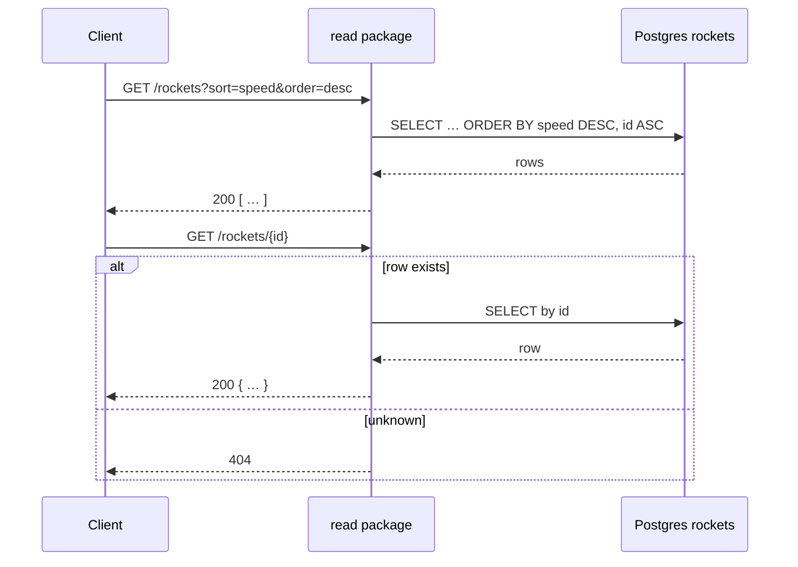

# P3 — Read APIs Implementation Plan

> **For agentic workers:** Prefer TDD (failing tests first). Combined plan+impl commit after Driver OK (per preferences).

**Status:** Driver OK — implemented (combined plan+impl commit on main).

**Goal:** Expose current rocket projection over HTTP: `GET /rockets` (list; empty → **200** + `[]`) and `GET /rockets/{id}` (**404** if unknown), with list sorting (`sort` + `order`). Read **only** from `rockets` current-state (P2 projection). **No** pagination, auth, CORS, or ingest/apply contract changes.

**Architecture:** Build on P0–P2 (`rockets` filled by contiguous apply). Logic lives under package `com.lunar.rockets.read`. Controllers/services map `rockets` rows → JSON DTOs. List sort is DB/`ORDER BY` (or equivalent stable in-memory sort over full list — scale is challenge-sized; **no pagination**). Default sort by `id` (channel) ascending for stability. Ingest + apply packages stay unchanged.



**Tech stack (locked):** Java 21 · Spring Boot 3.x · Maven · Spring Web · Spring Data JPA (reuse `rockets` entity/repo from apply **or** thin read-side query over same table) · Flyway schema already in place (no new migration expected) · PostgreSQL · Testcontainers / MockMvc for IT · single Spring Boot deployable · port **8088**

**Depends on:** P0 schema + P2 apply projection (`rockets` rows after contiguous apply). P1 ingest optional for end-to-end IT sequences (POST → apply → GET).

**Follows:** **P4** — coverage >90%, repeat harness + validate read APIs against applied state, README / `AI_USAGE`.

---

## Global constraints

- Paths exactly `GET /rockets` and `GET /rockets/{id}` on port **8088** (not `/api/v1/...`).
- `{id}` = channel UUID string (rocket ID = `metadata.channel`).
- Empty list → **200** + JSON `[]`.
- Unknown rocket → **404** (not 200 empty body).
- Sort: `sort=speed|mission|type` + `order=asc|desc` (default **`asc`**); default sort when `sort` omitted = **`id`** / channel.
- **No pagination** (ignore inventing `page` / `size` / cursors).
- Package seam: `com.lunar.rockets.read`. **No** `package-info.java`.
- YAGNI: no auth, CORS, Kafka, OpenAPI codegen, GraphQL, caching layer, Aurora readers impl (prod note only in docs/P4).
- Process: plan → Driver OK → implement (TDD) → review → Driver assess → commit (msg OK first).
- Do **not** guess remaining SPEC OPENs beyond the explicit P3 recommendation in §3.3 (Driver may trim/extend fields before impl).

---

## 1. Goals

1. Implement `GET /rockets` returning all projected rockets as a JSON array (**200**), including empty `[]`.
2. Implement `GET /rockets/{id}` returning one rocket (**200**) or **404** when no `rockets` row exists for that id.
3. Support list query params: `sort=speed|mission|type` and `order=asc|desc` (default `asc`); when `sort` omitted, order by `id` ascending (stable).
4. Document and ship a stable camelCase response DTO (see §3.3 recommendation — confirm with Driver if OPEN fields differ).
5. Keep responses consistent with applied state (integration: seed / apply → GET matches `rockets` columns).
6. Prove behavior with TDD: unit (sort mapping / DTO) + MockMvc or Testcontainers IT for empty/list/get/404/sort permutations.
7. Leave ingest HTTP and apply scheduler unchanged; no new Flyway version unless a real schema gap appears (none expected).

---

## 2. Non-goals (out of scope for P3)

- Changing `POST /messages` or apply claim/reduce semantics (**P1** / **P2** done).
- Pagination, filtering beyond sort, search, partial responses.
- Auth, CORS, OWASP, rate limiting.
- Live vendor harness re-run + read validation against harness output (**P4**).
- Coverage >90%, full README runbook, `AI_USAGE.md` polish (**P4**).
- Implementing Aurora reader replicas (docs-only prod note later).
- Exposing internal CAS `version` as a public API field (unless Driver explicitly asks).
- Resolving OPEN missing/late launch invent-vs-buffer (apply concern; reads only surface existing `rockets` rows).
- Git commit / push / hand-in / PRs (Driver gates). **This plan file must not be committed until Driver reviews.**

---

## 3. API contract

### 3.1 Endpoints

| Method / path | Success | Errors | Notes |
| --- | --- | --- | --- |
| `GET /rockets` | **200** + JSON array | Malformed sort/order → **400** (recommend) | Query: `sort`, `order` |
| `GET /rockets/{id}` | **200** + JSON object | Unknown id → **404**; unparseable UUID → **400** (Spring conversion) | `{id}` = channel UUID |

Port: **8088**. No request body. `Content-Type` response: `application/json`.

### 3.2 Sort query params (DECIDED)

| Param | Values | Default |
| --- | --- | --- |
| `sort` | `speed` \| `mission` \| `type` | omit → sort by **`id`** |
| `order` | `asc` \| `desc` | **`asc`** |

**Stability:** when primary keys tie (e.g. equal `speed`), secondary order by `id` ascending so list order is deterministic.

**Param name:** use **`sort`** (SPEC primary). Do **not** also invent `sortBy` unless Driver asks for alias compatibility — YAGNI one name.

**Invalid values:** unknown `sort` / `order` → **400** with a clear body/message (fail closed; do not silently ignore).

**No pagination:** do not implement `limit` / `offset` / `page`. Extra unknown query params may be ignored by Spring.

### 3.3 Response JSON shape (SPEC OPEN — P3 recommendation)

SPEC §5 leaves field names OPEN; recommendation is clear camelCase. **Propose for Driver OK (implement only after confirm / silence = use this):**

```json
{
  "id": "<uuid-string>",
  "type": "<string|null>",
  "speed": <number>,
  "mission": "<string|null>",
  "exploded": <boolean>,
  "explosionReason": "<string|null>"
}
```

| Field | Source column | Notes |
| --- | --- | --- |
| `id` | `rockets.id` | UUID string |
| `type` | `rockets.type` | From launch |
| `speed` | `rockets.speed` | `long` / JSON number; may be ≤ 0 |
| `mission` | `rockets.mission` | Latest applied mission |
| `exploded` | `rockets.exploded` | Sticky |
| `explosionReason` | `rockets.explosion_reason` | Null if not exploded |

**Defer / omit unless Driver asks:**

| Candidate | Why defer |
| --- | --- |
| `lastAppliedMessageNumber` | Useful debug; not required by brief wording — optional add-on if Driver wants |
| `lastMessageTime` | Not stored on `rockets` today; would need join/extra column — YAGNI for P3 |
| `version` | Internal CAS; do not leak |
| `updatedAt` | Internal/ops; omit unless Driver wants |

List response = JSON **array** of the same object shape. Single get = one object (not wrapped).

### 3.4 Consistency semantics

- Reads reflect **applied** projection only. Messages accepted but not yet applied do **not** appear as rockets / field updates until P2 apply commits.
- IT may: insert via ingest + wait/trigger apply, **or** seed `rockets` rows directly for pure read-contract tests.
- At most one row per id (PK); get-by-id is exact match.

---

## 4. Components

### 4.1 Controller (`RocketsController`)

- `@RestController` mapped to `/rockets`.
- `list(@RequestParam Optional sort, @RequestParam Optional order)` → `List<RocketResponse>`.
- `get(@PathVariable UUID id)` → `RocketResponse` or throw/not-found → **404**.
- Prefer `@ResponseStatus` / `ResponseStatusException(NOT_FOUND)` or a small read `@ControllerAdvice` — keep consistent with ingest error style where practical (ingest already has `IngestExceptionHandler`; read may use a dedicated handler or shared thin advice — **do not** overload ingest handler with read concerns).

### 4.2 Service (`RocketReadService`)

- `list(SortField, SortOrder)` → load all rockets ordered.
- `get(UUID id)` → `Optional` / throw not found.
- Map entity → DTO; no business apply logic.

### 4.3 Persistence

**Recommendation (YAGNI):** reuse `com.lunar.rockets.apply.persistence.RocketEntity` + `RocketRepository`, extending repository with sorted list queries **or** use Spring Data `Sort` / JPQL `ORDER BY`.

Alternatives OK if cleaner:

- Thin `RocketReadRepository` in `read.persistence` with native/JPQL select over `rockets` (avoid duplicating conflicting `@Entity` mappings — prefer one entity class).

Do **not** add a new Flyway migration for reads.

### 4.4 DTOs

- `RocketResponse` record (immutable) with Jackson-friendly camelCase names.
- Enums: `RocketSortField` (`SPEED`, `MISSION`, `TYPE`, `ID`), `SortOrder` (`ASC`, `DESC`).
- Parse query strings case-sensitively as lowercase tokens (`speed`, `asc`, …) unless Driver prefers case-insensitive — **recommend lowercase exact match** for simplicity.

### 4.5 File / layout sketch

```
src/main/java/com/lunar/rockets/read/
  api/
    RocketsController.java
    RocketResponse.java
    RocketSortField.java
    SortOrder.java          # or reuse a tiny shared name if collision-free
    ReadExceptionHandler.java   # optional; 404/400 mapping
  service/
    RocketReadService.java

src/test/java/com/lunar/rockets/read/
  api/RocketsControllerWebTest.java     # MockMvc: empty, 404, sort matrix
  api/RocketsReadIT.java                # Testcontainers: seed rockets / POST+apply → GET
  service/RocketReadServiceTest.java    # optional unit if logic warrants
```

No `package-info.java`.

---

## 5. Sort / query algorithm (normative)

```
on GET /rockets:
  order = parse(orderParam) or ASC
  if sortParam missing:
    primary = ID
  else:
    primary = parse(sortParam)  # speed|mission|type else 400
  rows = SELECT * FROM rockets
         ORDER BY <primary> <order>, id ASC
  return 200 + map(rows)

on GET /rockets/{id}:
  if id not UUID → 400
  row = findById(id)
  if missing → 404
  return 200 + map(row)
```

**Nulls:** `type` / `mission` may be null in DB edge cases; JSON null is fine. For `ORDER BY mission` / `type`, Postgres nulls-first/last — pick default DB behavior or explicit `NULLS LAST` and keep tests deterministic (seed non-null for sort ITs).

---

## 6. Test plan (TDD)

Write failing tests first; implement just enough to pass.

### 6.1 Web / contract (MockMvc or WebTestClient)

| Case | Expect |
| --- | --- |
| `GET /rockets` empty DB | **200**, body `[]` |
| `GET /rockets/{id}` unknown UUID | **404** |
| `GET /rockets/{known}` | **200**, fields match seeded rocket |
| `GET /rockets/{not-a-uuid}` | **400** (conversion) |
| Default list order | By `id` ascending |
| `sort=speed&order=asc` | Speeds non-decreasing; ties by `id` |
| `sort=speed&order=desc` | Speeds non-increasing |
| `sort=mission` / `sort=type` | Ordered accordingly |
| `order` omitted | Treated as `asc` |
| Invalid `sort` / `order` | **400** |
| Response field names | camelCase per §3.3 |
| Exploded rocket | `exploded: true`, `explosionReason` set |
| Speed ≤ 0 | Returned as-is (no clamp) |

### 6.2 Integration — consistency with projection

| Case | Expect |
| --- | --- |
| Seed / apply launch then GET by id | Matches type / speed / mission |
| POST messages + apply catch-up then `GET /rockets` | List contains projected rockets |
| Accept-only (not yet applied) message for new channel | GET by id still **404** until apply creates row |
| After explode + later mission apply | GET shows sticky explode + updated mission |

### 6.3 Explicitly not in P3 tests

- Live `./rockets` binary end-state vs reads (**P4**).
- Coverage percentage gate (**P4**).
- Apply SKIP LOCKED / reducer matrix (already P2).
- Ingest **400** schema matrix (already P1).
- Pagination behavior.

---

## 7. Exit criteria

P3 is done when all of the following hold:

1. **`GET /rockets`:** returns **200** + array; empty → `[]`.
2. **`GET /rockets/{id}`:** returns **200** for known; **404** for unknown.
3. **Sort:** `sort` + `order` behave per §3.2; default by `id` asc; invalid params **400**.
4. **No pagination** implemented.
5. **DTO:** documented camelCase shape shipped; matches checklist/SPEC minimum fields.
6. **Package:** logic under `com.lunar.rockets.read`; no `package-info.java`.
7. **No contract creep:** ingest/apply HTTP and scheduler unchanged; no unnecessary migration.
8. **TDD:** §6 tests written failing-first and green.
9. **Checklist:** mark landed read-API items in `docs/REQUIREMENTS_CHECKLIST.md` (see §10).
10. **Process:** Independent review + Driver assess; **commit only after Driver OK**; prefer combined plan+impl commit when authorized.

---

## 8. Risks & mitigations

| Risk | Mitigation |
| --- | --- |
| Guessing OPEN response fields | §3.3 recommendation; Driver confirms before/at plan OK |
| Sorting null `mission`/`type` flaky | Seed non-null in sort ITs; optional `NULLS LAST` |
| Read-your-writes vs async apply | Document eventual consistency; IT waits/triggers apply or seeds `rockets` |
| Leaking `version` / internal columns | Explicit DTO allow-list |
| Cross-package entity reuse debate | Single deployable YAGNI: reuse apply `RocketEntity`/repo or one shared mapping — review rejects duplicate entities |
| Accidental pagination / auth | Review rejects; YAGNI |
| Invalid UUID path vs 404 confusion | Document **400** for bad UUID, **404** only for well-formed unknown |
| Scope creep into P4 harness | Stop after HTTP read contract; harness+reads = P4 |

---

## 9. Task breakdown (post-approval implementation order)

Execute **only** after Driver OK on this plan (and on §3.3 field list if Driver edits it):

### Task 1: Failing read contract tests

- [x] MockMvc/Web: empty list, get known/unknown, 404, invalid sort/order.
- [x] Sort matrix: speed / mission / type × asc / desc + default by id.
- [x] DTO field assertions (camelCase + explode / speed ≤ 0).

### Task 2: Controller + DTO + service skeleton

- [x] `RocketsController`, `RocketResponse`, sort enums, `RocketReadService`.
- [x] 404 / 400 mapping.

### Task 3: Persistence wiring

- [x] Reuse or thin-query `rockets` with stable `ORDER BY` (+ secondary `id`).
- [x] No new Flyway unless unexpected gap (should be none).

### Task 4: Integration consistency

- [x] Seed and/or POST+apply → GET list/get match projection.
- [x] Not-yet-applied channel → still 404.

### Task 5: Green tests + checklist

- [x] All §6 tests green.
- [x] Update `docs/REQUIREMENTS_CHECKLIST.md` for landed P3 items (§10).
- [x] Combined plan+impl commit on main after Driver OK.

### Task 6: Stop — hand off to P4

- [x] Do **not** chase coverage % or harness re-run as P3 deliverables.
- [ ] Next phase plan: P4 verification + readiness.

---

## 10. Checklist items this phase will close

From `docs/REQUIREMENTS_CHECKLIST.md`:

- [x] Implement `GET /rockets` (empty → `200` + `[]`)
- [x] Implement `GET /rockets/{id}`
- [x] Implement list sorting query params
- [x] Integration tests: POST + GET against Spring / Testcontainers as needed *(GET half; POST already exists — add read ITs / combined sequences)*

Related process (partial):

- [x] Master + per-phase plans … *(P3 plan approved + landed; P4 still TBD)*

**Explicitly leave unchecked for P4:** harness re-run + read validation vs harness; measured coverage >90%; README / `AI_USAGE`; interview readiness docs.

---

## 11. Commit one-liner (propose after impl; do not commit yet)

```text
feat: add GET /rockets read APIs with sort
```

---

## 12. Gate

**Driver OK** on plan + §3.3 fields. Implemented TDD; combined commit on main. Next: **P4** verification plan.
