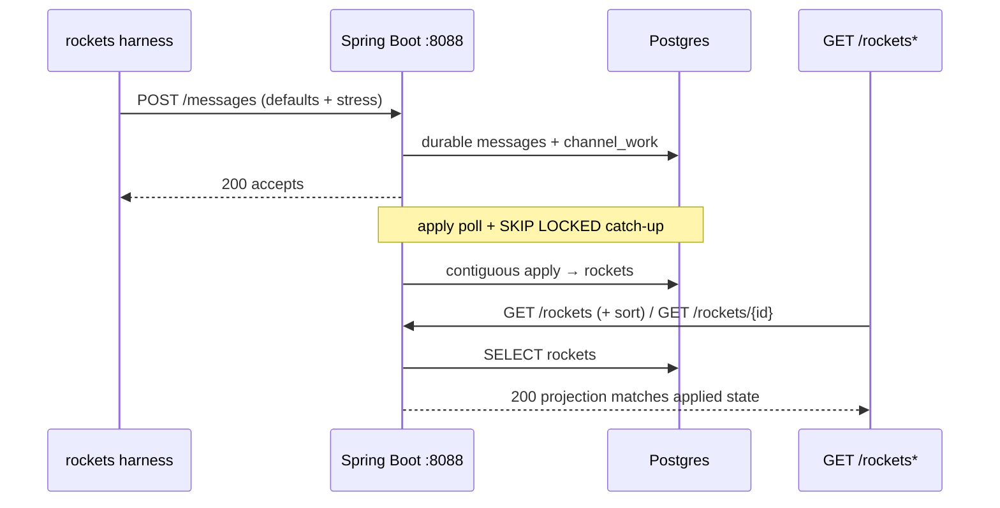

# P4 — Verification + readiness

> **For agentic workers:** Prefer filling coverage gaps with TDD (failing tests first) where code is missing; harness + read validation is **verification**, not new product features. Combined plan+impl/docs commit after Driver OK (per preferences). **Implemented after Driver OK (LB-21).**

**Status:** **PASS** (Driver OK → implemented 2026-11-13, LB-21). Evidence in §3.3 / §4.7.

**Goal:** Close the quality and interview bar: measured line/branch coverage **> 90%** (Jacoco), **repeat** live harness (P1.1-style defaults + stress knobs) against `http://localhost:8088/messages`, then validate **read APIs** (`GET /rockets`, `GET /rockets/{id}`, sort) against **applied** projection; polish README runbook + honest `AI_USAGE.md`; bring checklist current; document design/trade-offs for a ~10 min breadth-first interview narrative.

**Architecture:** No new product packages. Reuse P0–P3 stack as-is (`ingest` / `apply` / `read`). Verification path:



**Tech stack (locked, unchanged):** Java 21 · Spring Boot 3.x · Maven · Postgres (Docker) · Testcontainers / existing suites · vendor harness under `rockets/` · **add** Jacoco (maven plugin) for measured coverage gate

**Depends on:** P0–P3 landed; P1.1 harness smoke already proved ingest accept path (this phase **repeats** harness and **adds** read validation after apply).

**Follows:** Driver assess → commit (msg OK) → push / hand-in **only** when Driver authorizes (out of scope as code work).

---

## Global constraints

- Coverage bar **> 90%** measured and recorded (SPEC §8 DECIDED). Prioritize critical paths: ingest idempotency, contiguous apply/ordering, read APIs.
- Harness: real binary `./rockets/darwin_arm64/rockets` or `./rockets/darwin_amd64/rockets` (host arch); target `http://localhost:8088/messages`.
- Re-run **defaults** and at least one **non-default** `--message-delay` **and** `--concurrency-level` (P1.1 pattern: e.g. `50ms` / `8`).
- After harness + apply catch-up: assert **read APIs** match applied `rockets` (not only `messages` / `channel_work` durability).
- YAGNI: no new product features, auth, CORS, pagination, wake-on-ingest impl, Aurora readers impl (docs note only), CI harness hard-gate unless Driver asks.
- Process: plan → Driver OK → implement/verify → review → Driver assess → commit (msg OK first). **This plan file must not be committed until Driver reviews.**
- Do **not** reopen DECIDED architecture or remaining SPEC OPENs (missing/late launch invent-vs-buffer; overflow UX beyond `long` + document).

---

## 1. Goals

1. Wire **Jacoco** (or equivalent Maven coverage plugin) so `./mvnw verify` (or `make test`) produces a measured report; fail or clearly gate when overall / critical-path coverage ≤ 90%.
2. Fill test gaps (unit / integration / e2e-oriented) until measured coverage **> 90%**, focusing on ingest idempotency, apply/ordering, read APIs.
3. Bring app + Postgres up on **8088**; pick correct **darwin** harness binary.
4. Run harness **defaults** and **stress** (non-default delay + concurrency), with bounded `--max-messages` as in P1.1 so runs finish in-session.
5. Wait for apply catch-up; assert `messages` / `channel_work` / `rockets` coherence; then validate **`GET /rockets`**, **`GET /rockets/{id}`**, and at least one **sort** query against applied state.
6. Polish **README** into a full runbook: build, run on 8088, APIs, tests, harness, design/trade-off notes (incl. Aurora writer/readers prod note).
7. Create honest **`AI_USAGE.md`** with point time estimates (process deliverable; none exists yet).
8. Update **`docs/REQUIREMENTS_CHECKLIST.md`** for all P4-landed verification / readiness items.
9. Leave interview narrative (~10 min breadth-first) explainable from README + plans + checklist.

---

## 2. Non-goals (out of scope for P4)

- New product features beyond SPEC (no new endpoints, schemas, wake-on-ingest code).
- Implementing Aurora reader replicas (README/prod note only).
- Resolving OPEN missing/late `RocketLaunched` invent-vs-buffer (document known OPEN; do not invent behavior).
- Automating vendor harness as a mandatory CI gate (optional Makefile helper OK only if Driver asks; documented manual commands suffice).
- Linux/Windows harness trees as primary evidence — target **darwin** on Driver/worker Mac (note other trees exist under `rockets/`).
- Git push / ZIP / public hand-in (Driver gates separately after assess).
- Reopening P0–P3 contracts.

---

## 3. Coverage (> 90%)

### 3.1 Tooling

1. Add **Jacoco** Maven plugin (`prepare-agent` + `report` + optional `check` with `minimum` **0.90** on agreed counter — recommend **LINE** instruction coverage overall; document if branch bar is softer).
2. Ensure unit + failsafe IT classes are included in the report (Jacoco + surefire/failsafe agent).
3. Document command: `make test` / `./mvnw verify` → open `target/site/jacoco/index.html` (or `target/site/jacoco/jacoco.xml` for CI-style check).
4. Optional: `make coverage` target that runs verify and prints the Jacoco summary line.

### 3.2 Gap fill strategy

1. Run report once; list packages/classes under 90% or critical paths lightly covered.
2. Prefer tests over production refactors. Add failing tests first for:
   - Ingest: duplicate first-wins, **400** matrix leftovers, transient **5xx** path if thin.
   - Apply: gap wait, sticky explode + continue, speed ≤ 0, multi-claim / SKIP LOCKED (already have — extend only if coverage holes).
   - Read: empty list, 404, sort permutations, consistency after apply.
   - Thin e2e-style IT: out-of-order + duplicate POST sequence → apply → GET matches (closes checklist “E2E / harness-oriented” for automated half).
3. Do **not** chase 100% or coverage of generated/boilerplate noise — exclude only with Driver OK if needed (e.g. main method). Prefer raising real tests.

### 3.3 Evidence

Record in this plan’s evidence appendix (after run) or checklist comment:

| Metric | Target | Actual |
| --- | --- | --- |
| Jacoco line (instruction) coverage | **> 90%** | **96.55%** LINE (420/435); INSTRUCTION 95.97% |
| Report path | `target/site/jacoco/index.html` | `target/site/jacoco/index.html` (+ `jacoco.xml`) |

---

## 4. Harness re-run + read validation

Mirror P1.1 §3 with **apply + reads** added. Prefer documenting commands + evidence over automation.

### 4.1 Preconditions

1. Confirm P1–P3 on branch under test (`POST /messages`, apply scheduler, `GET /rockets*`).
2. Confirm binaries: `rockets/darwin_arm64/rockets`, `rockets/darwin_amd64/rockets`.
3. Pick binary: `uname -m` → `arm64` ⇒ `darwin_arm64`; `x86_64` ⇒ `darwin_amd64`. `chmod +x` if needed.

### 4.2 Bring up app + Postgres

```bash
make up          # Postgres via docker compose
make run         # Spring Boot on 8088
# optional: make smoke  # actuator health UP
# alternative (stable under agents): docker compose up -d --build
```

Use a clean DB (or truncate `messages` / `channel_work` / `rockets` between runs) so counts are interpretable.

### 4.3 Default harness run

```bash
./rockets/darwin_arm64/rockets launch "http://localhost:8088/messages" \
  --max-messages=200
# Intel Mac: ./rockets/darwin_amd64/rockets …
# BRIEF-style defaults: --message-delay=500ms --concurrency-level=1
```

**Expect:** harness exit 0; accepts **200**; app stays up.

### 4.4 Stress run (non-default delay + concurrency)

```bash
./rockets/darwin_arm64/rockets launch "http://localhost:8088/messages" \
  --message-delay=50ms \
  --concurrency-level=8 \
  --max-messages=400
```

**Expect:** harness completes without protocol failure under load/reorder pressure.

### 4.5 Wait for apply catch-up

After each run (or once after both if DB left dirty between):

- Poll until idle: e.g. no dirty unclaimed work **or** `COUNT(*)` of unapplied `messages` → 0 for harness channels, **or** allow a bounded sleep longer than poll cadence × expected batches.
- SQL sanity:

```sql
SELECT COUNT(*) FROM messages;
SELECT COUNT(*) FROM messages WHERE applied = false;  -- expect 0 after catch-up (for contiguous sequences from harness)
SELECT COUNT(*) FROM channel_work;
SELECT COUNT(*) FROM rockets;
-- channels in messages with contiguous apply should appear in rockets when launch applied
```

**Expect:** applied projection populated; no permanent “accepted but never claimable” gap (`messages` channels ⊆ `channel_work` at accept time; after apply, rockets reflect contiguous progress).

### 4.6 Validate read APIs against applied state

```bash
# List
curl -sS "http://localhost:8088/rockets" | jq 'length'
curl -sS "http://localhost:8088/rockets?sort=speed&order=desc" | jq '.[0:3]'

# Spot-check one id from list
ID=$(curl -sS "http://localhost:8088/rockets" | jq -r '.[0].id')
curl -sS "http://localhost:8088/rockets/$ID" | jq .
curl -sS -o /dev/null -w "%{http_code}\n" "http://localhost:8088/rockets/00000000-0000-0000-0000-000000000000"
# expect 404 for unknown
```

**Assert:**

| Check | Expect |
| --- | --- |
| `GET /rockets` length | **> 0** after harness + apply; equals `COUNT(*)` from `rockets` |
| Sample `GET /rockets/{id}` | Fields match DB row (`id`, `type`, `speed`, `mission`, `exploded`, `explosionReason`) |
| Sort smoke | `sort=speed&order=desc` (or `mission`/`type`) returns ordered list; invalid sort → **400** |
| Unknown id | **404** |
| Empty before first launch apply | N/A if harness already applied — optional truncate + empty `[]` already covered by P3 ITs |

Do **not** require bit-exact replay of every harness message into hand-computed state — validate **projection consistency** (HTTP ↔ `rockets` table) after apply converges.

### 4.7 Evidence table (fill after runs)

| Run | Binary | `--message-delay` | `--concurrency-level` | `--max-messages` | Harness | Apply catch-up | `messages` | `rockets` | `GET /rockets` len | Notes |
| --- | --- | --- | --- | --- | --- | --- | --- | --- | --- | --- |
| defaults | `darwin_arm64` | `500ms` | `1` | `200` | **PASS** (exit 0; 200 sent; no error/retry) | **PASS** (`unapplied=0`) | **200** | **20** | **20** (after both runs + catch-up) | compose app :8088 |
| stress | `darwin_arm64` | `50ms` | `8` | `400` | **PASS** (exit 0; 400 sent; no error/retry) | **PASS** (`unapplied=0`) | **400** (union w/ defaults) | **20** | **20** matches DB | sort desc + get-by-id + 404 OK |

---

## 5. README polish

Expand root `README.md` from P0 local-up notes into a submission/interview runbook. Keep links to `docs/`.

### 5.1 Required sections

1. **What it is** — one paragraph (harness-driven rocket state service).
2. **Stack** — Java 21, Spring Boot 3.x, Maven, Postgres.
3. **Local up** — `make up` / `make run` / compose; port **8088**; health check.
4. **APIs** — `POST /messages`, `GET /rockets`, `GET /rockets/{id}`; sort params; status policy (**200** / **400** / **5xx** / **404**); example curls.
5. **Tests** — `make test`; Jacoco report path; coverage bar.
6. **Harness** — binary selection; defaults + stress examples; note apply catch-up before trusting GETs.
7. **Design / trade-offs** (breadth-first interview anchors):
   - Durable ingest → **200**; async contiguous apply (DECIDED option 3 + B).
   - Multi-pod: `FOR UPDATE SKIP LOCKED` + `rockets.version`.
   - First-wins duplicates; sticky explode + continue; speed ≤ 0 allowed.
   - Single deployable; packages `ingest` / `apply` / `read`.
   - **Prod note:** Aurora-style writer + readers for GET when eventual consistency is OK (docs only — not implemented).
   - Deferred: wake-on-ingest → `docs/NEXT_STEPS.md`.
8. **Known OPENs** — missing/late launch invent-vs-buffer; huge `by` / overflow (`long` + document).

### 5.2 Explicitly avoid

- Auth/CORS/OWASP essays.
- Fake microservices roadmap as if shipped.
- Duplicating entire SPEC — link to `docs/SPEC.md` / plans.

---

## 6. AI_USAGE.md

Create **`AI_USAGE.md`** at repo root (SPEC §9 / checklist). Honest process log — not marketing.

### 6.1 Suggested shape

```markdown
# AI usage

## Summary
- Tools / agents used (Cursor agents, etc.)
- What AI did vs Driver decisions

## Point estimates (hours)
| Phase / activity | Estimate | Notes |
| --- | --- | --- |
| Spec / checklist / master plan | … | |
| P0 … P4 | … | |
| Reviews / harness verification | … | |
| **Total** | … | |

## Reflections
- What worked / what needed Driver OK
- Agentic coding takeaways for interview
```

Use best-effort point times from the session (do not invent precision). Update once at end of P4 work before Driver assess.

---

## 7. Interview / prod readiness

Checklist for Driver assess (no separate slide deck required):

1. **Breadth-first ~10 min story** runnable from README + master plan:
   - Problem → ingest/apply/read seams → Postgres claim → reads → verification (tests + harness + coverage).
2. **Depth hooks** ready if asked: SKIP LOCKED exclusivity, first-wins, sticky explode, gap handling, idempotent POST.
3. **Verification story:** unit/IT matrix + measured >90% + live harness defaults/stress + GET consistency.
4. **Prod notes** called out as docs-only (Aurora readers; wake deferred).
5. Checklist living and current; no unchecked items that this phase owns (except Driver-deferred wake).

---

## 8. Exit criteria

P4 is done when all of the following hold:

1. **Coverage:** Jacoco (or agreed tool) reports **> 90%**; evidence recorded.
2. **Suites:** unit + integration + e2e-oriented cases cover out-of-order + duplicates (automated); critical paths exercised.
3. **Harness:** defaults + stress (non-default delay **and** concurrency) complete successfully on darwin binary → `:8088/messages`.
4. **Reads:** after apply catch-up, `GET /rockets` / `{id}` / sort match applied `rockets` projection; unknown → **404**.
5. **README:** full runbook + design/trade-off + prod note.
6. **`AI_USAGE.md`:** present with honest point estimates.
7. **Checklist:** P4-owned items marked in `docs/REQUIREMENTS_CHECKLIST.md` (see §11).
8. **Process:** Independent review + Driver assess; **commit only after Driver OK**; prefer combined plan+impl/docs commit when authorized.
9. **No push / hand-in** without separate Driver OK.

---

## 9. Risks & mitigations

| Risk | Mitigation |
| --- | --- |
| Coverage stuck ≤90% on boilerplate | Prefer real tests; exclude only with Driver OK; focus critical packages first |
| Harness run too long | Bound `--max-messages` (P1.1: 200/400); knobs under test remain delay + concurrency |
| Reads race apply | Explicit catch-up wait / SQL unapplied=0 before GET asserts |
| Flaky host `make run` under agents | Prefer compose `app` service (P1.1 note) |
| Over-scoping wake / Aurora | Docs only; review rejects impl |
| Dishonest AI_USAGE | Point estimates; say unknowns; Driver edits OK |
| Treating P1.1 ingest-only evidence as P4 done | Must re-run harness **and** validate reads |

---

## 10. Task breakdown (post-approval implementation order)

Execute **only** after Driver OK on this plan:

### Task 1: Jacoco + baseline report

- [x] ~~Add Jacoco plugin (+ optional `check` at 0.90).~~
- [x] ~~Run `./mvnw verify`; capture baseline %.~~
- [x] ~~Optional `make coverage` helper.~~

### Task 2: Fill coverage / e2e gaps (TDD)

- [x] ~~Identify holes on ingest / apply / read critical paths.~~
- [x] ~~Add failing tests → implement only if production bugs found (prefer tests).~~
- [x] ~~Confirm measured coverage **> 90%**.~~

### Task 3: Harness defaults + stress

- [x] ~~App + Postgres up on **8088**.~~
- [x] ~~Default launch (bounded max-messages).~~
- [x] ~~Stress launch (`50ms` / `8` or equivalent).~~
- [x] ~~Record harness outcomes.~~

### Task 4: Apply catch-up + read validation

- [x] ~~Wait until applied / SQL coherent.~~
- [x] ~~Assert `GET /rockets` length ↔ `rockets` count.~~
- [x] ~~Spot-check get-by-id + sort + unknown **404**.~~
- [x] ~~Fill §4.7 evidence table.~~

### Task 5: README + AI_USAGE + checklist

- [x] ~~Expand README per §5.~~
- [x] ~~Create `AI_USAGE.md` per §6.~~
- [x] ~~Mark checklist items per §11.~~
- [x] ~~Interview readiness skim (§7).~~

### Task 6: Stop — Driver assess

- [x] ~~Propose commit one-liner (§12); Driver authorized combined commit on main.~~
- [x] ~~No push / hand-in until separately authorized.~~ (commit authorized; push gated separately if needed)

---

## 11. Checklist items this phase will close

From `docs/REQUIREMENTS_CHECKLIST.md`:

- [x] ~~`AI_USAGE.md` with honest point time estimates~~
- [x] ~~README runbook (build, run on 8088, APIs, tests/harness)~~
- [x] ~~E2E / harness-oriented: out-of-order + duplicates (+ optional `./rockets/<platform>/rockets`)~~
- [x] ~~Measured coverage > 90%~~
- [x] ~~Design choices & trade-offs documented (README / plans)~~
- [x] ~~Depth: concurrency, persistence, error handling explainable~~
- [x] ~~Verification story clear for interview (~10 min breadth-first)~~

Also update process line if needed:

- [x] ~~Master + per-phase plans … (P4 plan Driver OK)~~

**Leave unchecked (deferred, not P4 impl):**

- Optional same-pod wake hint — `docs/NEXT_STEPS.md`

---

## 12. Commit one-liner (propose after work; do not commit yet)

```text
chore: P4 verification coverage harness reads and readiness docs
```

---

## 13. Gate

**Executed.** Driver OK → Jacoco + gap tests (>90%) → harness defaults/stress → apply catch-up + GET/sort validation → README / `AI_USAGE` / checklist → combined commit on `main` with authorized one-liner. **No package-info.** Push/hand-in remain separately gated unless Driver says otherwise.
